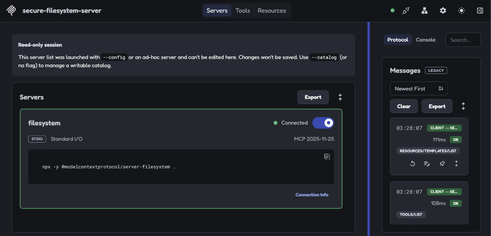
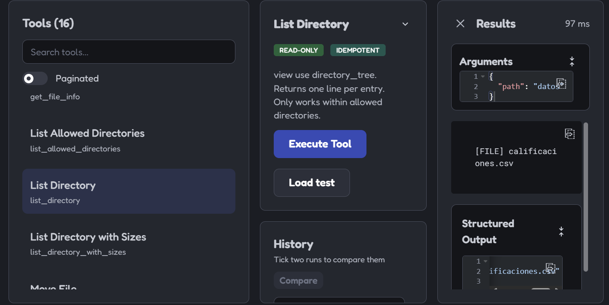
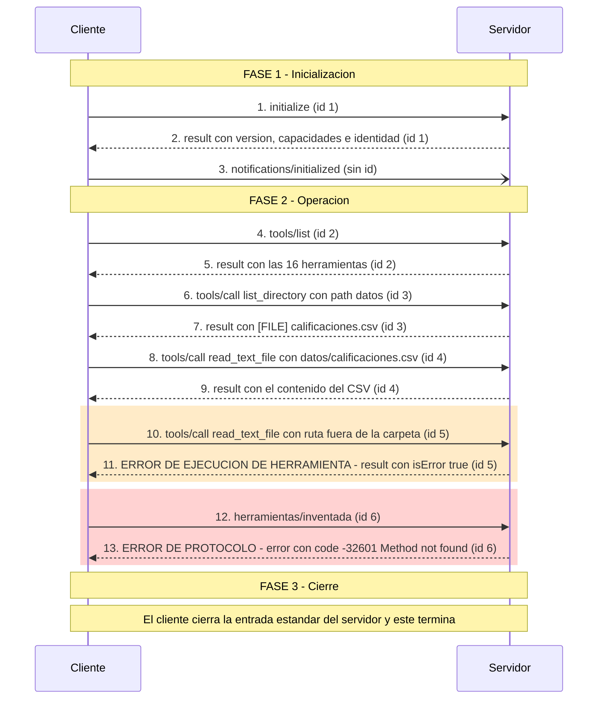

# Práctica 2: Ver el protocolo MCP por dentro

## 1. Descripción

Esta práctica muestra los mensajes JSON-RPC 2.0 que viajan entre un cliente y un servidor del Model Context Protocol (MCP). Primero los observé con el MCP Inspector y después los reproduje con un cliente propio de unas 70 líneas, sin bibliotecas, que se conecta por stdio al servidor `filesystem`.

| Elemento | Versión usada |
|---|---|
| Sistema operativo | Windows 11 Home, con PowerShell 5.1 |
| Node.js | v26.13.1 |
| Git | 2.55.0.windows.5 |
| MCP Inspector | 2.15.0 |
| Servidor `@modelcontextprotocol/server-filesystem` | 2.3.0 (`serverInfo.version`) |
| Navegador | Google Chrome |
| Fecha de realización | 16 de noviembre de 2026 |

Con esta práctica entendí que MCP no es nada misterioso: son objetos JSON, uno por línea, que el cliente escribe en la entrada estándar del servidor y que el servidor contesta por su salida estándar. Con un programa de unas 70 líneas pude hacer lo mismo que hace el Inspector: inicializar la conexión, listar las herramientas y llamar a una de ellas. También aprendí a distinguir un error de protocolo de un error de la herramienta.

## 2. Requisitos y reproducción

**Requisitos**

- Node.js 22.19 o superior (requisito del MCP Inspector).
- Git.
- Un navegador (Chrome, Edge o Firefox).
- Conexión a internet la primera vez, para descargar el Inspector y el servidor con `npx`.

**Pasos para repetir la práctica** (en PowerShell):

```powershell
git clone https://github.com/gabogabon/practica2-mcp.git
cd practica2-mcp
```

1. Cliente propio (genera `salida/traza.jsonl`, 13 mensajes):

```powershell
node cliente_mcp.mjs
```

2. MCP Inspector (abre el navegador, activa el interruptor de la tarjeta `filesystem`):

```powershell
npx -y "@modelcontextprotocol/inspector" --config mcp.json
```

Si PowerShell bloquea `npx` por la política de ejecución, consulta la sección 8.

Nota: `salida/historial_inspector.json` y las capturas son evidencia de mi ejecución. Al volver a correr el Inspector se generaría un historial nuevo.

## 3. Actividad A: observar el protocolo con el MCP Inspector

### Datos de la inicialización

| Dato | Valor |
|---|---|
| Versión propuesta por el cliente | `2025-11-25` |
| Versión aceptada por el servidor | `2025-11-25` |
| Servidor (`serverInfo`) | `secure-filesystem-server`, versión `2.3.0` |
| Capacidades del servidor | `tools` (`listChanged: true`) y `resources` (`listChanged: true`) |
| Cliente (`clientInfo`) | `mcp-inspector`, versión `2.15.0` |
| Capacidades del cliente | `sampling`, `elicitation` (`form`, `url`), `roots` (`listChanged: true`), `tasks`, `extensions` |
| Mensaje del servidor al cliente | `roots/list` (la respuesta del Inspector fue `roots: []`) |
| Herramientas que ofrece el servidor | 16 |

### Mensajes en orden cronológico

Fuente: `salida/historial_inspector.json`. Las horas están en UTC, tal como las registra el archivo.

| # | Hora (UTC) | Dirección | Método | Tipo | id |
|---|---|---|---|---|---|
| 1 | 02:29:30 | Cliente → Servidor | `initialize` | Solicitud | 0 |
| 2 | 02:29:33 | Cliente → Servidor | `notifications/initialized` | Notificación | sin id |
| 3 | 02:29:33 | Servidor → Cliente | `roots/list` | Solicitud | 0 |
| 4 | 02:29:33 | Cliente → Servidor | `resources/list` | Solicitud | 1 |
| 5 | 02:29:33 | Cliente → Servidor | `tools/list` | Solicitud | 2 |
| 6 | 02:29:33 | Cliente → Servidor | `resources/templates/list` | Solicitud | 3 |
| 7 | 03:00:43 | Cliente → Servidor | `tools/list` | Solicitud | 4 |
| 8 | 03:00:43 | Cliente → Servidor | `prompts/list` | Solicitud | 5 |
| 9 | 03:00:43 | Cliente → Servidor | `resources/list` | Solicitud | 6 |
| 10 | 03:01:47 | Cliente → Servidor | `tools/call` | Solicitud | 7 |
| 11 | 03:04:30 | Cliente → Servidor | `tools/call` | Solicitud | 8 |

Observaciones:

- El Inspector exporta cada solicitud junto con su respuesta en un mismo elemento, por eso el archivo tiene 11 elementos aunque en el protocolo viajaron más mensajes sueltos.
- `prompts/list` recibió un error de protocolo (`code: -32601`, `Method not found`), porque el servidor no declaró la capacidad `prompts`.
- Los `id` del Inspector empiezan en 0. Los `id` de `roots/list` los numera el servidor por separado.
- Los dos `tools/call` fueron `list_directory` (con `path: datos`, que devolvió `[FILE] calificaciones.csv`) y `get_file_info`.

Lo que más me llamó la atención de la inicialización fue el mensaje `roots/list`, que va del servidor al cliente. Yo esperaba que siempre preguntara el cliente, pero como el Inspector declaró la capacidad `roots`, el servidor le pidió sus carpetas de trabajo. El Inspector contestó con una lista vacía (`roots: []`). También vi que cada lado numera sus propias solicitudes, por eso hay dos mensajes con `id` 0 que no tienen relación entre sí.

### Capturas





## 4. Actividad B: un cliente MCP mínimo

Archivo: `cliente_mcp.mjs`. Resultado: `salida/traza.jsonl` con 7 líneas (4 del cliente y 3 del servidor). El último mensaje contiene `[FILE] calificaciones.csv`.

| # | Dirección | Método o contenido | Tipo | id |
|---|---|---|---|---|
| 1 | Cliente → Servidor | `initialize` (versión `2025-06-18`, `capabilities: {}`, `clientInfo: cliente-minimo 1.0.0`) | Solicitud | 1 |
| 2 | Servidor → Cliente | `result` con versión `2025-06-18`, capacidades `tools` y `resources`, e identidad del servidor | Respuesta | 1 |
| 3 | Cliente → Servidor | `notifications/initialized` | Notificación | sin id |
| 4 | Cliente → Servidor | `tools/list` | Solicitud | 2 |
| 5 | Servidor → Cliente | `result` con las 16 herramientas y sus definiciones | Respuesta | 2 |
| 6 | Cliente → Servidor | `tools/call` (`list_directory`, `path: datos`) | Solicitud | 3 |
| 7 | Servidor → Cliente | `result` con `[FILE] calificaciones.csv` | Respuesta | 3 |

Las líneas sueltas como `Secure MCP Filesystem Server running on stdio` salen por stderr del servidor y no son mensajes del protocolo, por eso no están en la tabla.

### Qué función produjo cada mensaje

- Mensajes 1, 4 y 6: `solicitar()`, que asigna el `id` con `siguienteId++` y guarda la promesa en el mapa `pendientes`.
- Mensaje 3: `notificar()`, sin `id`.
- Mensajes 2, 5 y 7: llegan por el lector de líneas (`createInterface`), que busca en `pendientes` la promesa con el mismo `id` y la resuelve.
- Todos se registran con `registrar()`.

### Descripción de `list_directory`

Según la respuesta a `tools/list`, `list_directory` sirve para ver qué hay directamente dentro de una carpeta: devuelve una línea por entrada y marca cada una como `[FILE]` si es archivo o `[DIR]` si es carpeta. Su descripción aclara que si necesito los tamaños o quiero ordenar por tamaño debo usar `list_directory_with_sizes`, y que para ver el contenido de forma recursiva (subcarpetas incluidas) existe `directory_tree`. También dice que solo funciona dentro de los directorios permitidos.

Su `inputSchema` exige un único parámetro, `path`, que es obligatorio (`required`) y de tipo texto. Puede ser una ruta absoluta o relativa, pero tiene que quedar dentro de los directorios permitidos.

Sus `annotations` describen cómo se comporta la herramienta: `readOnlyHint: true` significa que solo lee y no modifica nada, `idempotentHint: true` que llamarla varias veces con lo mismo da el mismo resultado, `destructiveHint: false` que no borra ni destruye datos, y `openWorldHint: false` que solo trabaja con el sistema de archivos local y no con el mundo exterior. Además tiene un `outputSchema` que promete un resultado con un campo `content` de tipo texto, por eso la respuesta trae `content` y `structuredContent`.

## 5. Actividad C: ampliar la conversación

Resultado: `salida/traza.jsonl` con 13 mensajes. Código agregado antes del paso 5 de `cliente_mcp.mjs`:

```javascript
// Actividad C: tres solicitudes nuevas.
// 1. Lectura correcta.
await solicitar('tools/call', {
  name: 'read_text_file',
  arguments: { path: 'datos/calificaciones.csv' },
});

// 2. Lectura prohibida: ruta fuera de la carpeta de la practica.
await solicitar('tools/call', {
  name: 'read_text_file',
  arguments: { path: 'C:/Windows/win.ini' },
});

// 3. Metodo que no existe.
await solicitar('herramientas/inventada', {});
```

### Las dos respuestas fallidas (copiadas de la traza)

Por privacidad sustituí mi nombre de usuario de Windows por `TU_USUARIO` en `salida/traza.jsonl` y en este README.

**Respuesta con `id` 5 (lectura prohibida):**

```json
{"direccion":"SERVIDOR -> CLIENTE","mensaje":{"result":{"content":[{"type":"text","text":"Access denied - path outside allowed directories: C:\\Windows\\win.ini not in C:\\Users\\TU_USUARIO\\Documents\\practica2-mcp"}],"isError":true},"jsonrpc":"2.0","id":5}}
```

**Respuesta con `id` 6 (método inexistente):**

```json
{"direccion":"SERVIDOR -> CLIENTE","mensaje":{"jsonrpc":"2.0","id":6,"error":{"code":-32601,"message":"Method not found"}}}
```

### Diferencia entre los dos errores

| | `id` 5 (`win.ini`) | `id` 6 (`herramientas/inventada`) |
|---|---|---|
| Clase | Error de ejecución de herramienta | Error de protocolo |
| Campos que lo delatan | `result` con `isError: true` y el motivo en `content[0].text` | `error` con `code: -32601` y `message`, sin `result` |

La respuesta con `id` 6 es un **error de protocolo**: el servidor no pudo atender el mensaje porque el método `herramientas/inventada` no existe, y por eso la respuesta trae el campo `error` (con `code` y `message`) en lugar de `result`. Es el mismo `-32601` que vi en el Inspector con `prompts/list`.

La respuesta con `id` 5 es un **error de ejecución de herramienta**: el servidor sí entendió la solicitud y la herramienta `read_text_file` se ejecutó, pero se negó a leer `C:/Windows/win.ini` porque esa ruta está fuera de la carpeta permitida. Por eso la respuesta es un `result` normal, con el motivo escrito en `content` y marcado con `"isError": true`. Reconocí cada caso por los campos: `error` sin `result` en el primero, y `result` con `isError: true` en el segundo.

## 6. Actividad D: comparar dos clientes

| | Inspector | Cliente mínimo |
|---|---|---|
| Nombre y versión del cliente (`clientInfo`) | `mcp-inspector` 2.15.0 | `cliente-minimo` 1.0.0 |
| Versión del protocolo que propuso el cliente | `2025-11-25` | `2025-06-18` |
| Versión del protocolo que respondió el servidor | `2025-11-25` | `2025-06-18` |
| Capacidades que declaró el cliente | `sampling`, `elicitation`, `roots`, `tasks`, `extensions` | Ninguna (`{}`) |
| ¿El servidor envió una solicitud al cliente? ¿Cuál? | Sí: `roots/list` | No |

El servidor se comportó distinto porque cada cliente declaró capacidades distintas en `initialize`. El Inspector declaró `roots`, así que el servidor pudo pedirle sus carpetas de trabajo con `roots/list`. Mi cliente mínimo declaró `capabilities: {}`, es decir, ninguna, y como ningún lado debe usar una capacidad que el otro no declaró, el servidor no le envió ninguna solicitud. Por eso la traza de mi cliente solo tiene mensajes que él mismo inició y sus respuestas.

### Experimento: versión de protocolo inexistente

Cambié temporalmente `protocolVersion` a `'1999-01-01'` y ejecuté el cliente. El servidor no devolvió un `error`, sino un `result` normal con `protocolVersion: "2025-11-25"`. Con `2025-06-18` había respondido `2025-06-18`. Después restauré el valor original y volví a ejecutar el cliente, para que la traza quedara con los 13 mensajes.

Interpreto que el servidor soporta al menos las versiones `2025-06-18` y `2025-11-25`. Si el cliente propone una versión que soporta, la acepta y responde con la misma. Si propone una que no soporta, como `1999-01-01`, responde con otra que sí soporta (en mi caso `2025-11-25`) y deja que el cliente decida. Mi cliente mínimo no revisa esa respuesta y continúa de todos modos, pero un cliente completo debería desconectarse si no soporta la versión que el servidor eligió. Esto lo deduzco solo de lo que observé en mis ejecuciones.

## 7. Actividad E: diagrama de secuencia



## 8. Problemas encontrados

1. **PowerShell bloqueó `npx`.** Mensaje: "No se puede cargar el archivo npx.ps1 porque la ejecución de scripts está deshabilitada en este sistema". La causa es la política de ejecución de PowerShell, que bloquea `npx.ps1`. Lo resolví con `Set-ExecutionPolicy -Scope CurrentUser -ExecutionPolicy RemoteSigned`, que solo afecta a mi usuario.
2. **Avisos de Git "LF will be replaced by CRLF".** Aparecieron en el primer `git add`. Son normales en Windows, porque Git convierte los saltos de línea, y no afectan la práctica.
3. **Versiones distintas a las de la guía.** La guía reporta Inspector 2.13.0, servidor 2.2.0 y Node v24.12.0, y yo trabajé con Inspector 2.15.0, servidor 2.3.0 y Node v26.13.1. Todo funcionó igual.
4. **La traza tenía 14 líneas en lugar de 13.** Había una línea de más después de reemplazar mi usuario con `Set-Content`. Lo resolví regenerando la traza con `node cliente_mcp.mjs` y haciendo el reemplazo con `[System.IO.File]::WriteAllText`, y después comprobé que el conteo daba 13.
5. **Privacidad antes de publicar.** La clave de acceso del Inspector aparece en la barra de direcciones, así que recorté esa parte de las capturas. El mensaje de error de la actividad C incluía mi usuario de Windows, y lo sustituí por `TU_USUARIO`. Como cada ejecución del cliente regenera la traza, repetí la sustitución después de la última ejecución y comprobé con `Select-String` que ya no aparecía mi usuario en ningún archivo.

## 9. Fuentes

- Especificación de MCP: https://modelcontextprotocol.io/specification
- Especificación de JSON-RPC 2.0: https://www.jsonrpc.org/specification
- MCP Inspector: https://github.com/modelcontextprotocol/inspector
- Servidor filesystem: https://github.com/modelcontextprotocol/servers
- Diagramas de secuencia en Mermaid: https://mermaid.js.org/syntax/sequenceDiagram.html
- Guía de la práctica 2 proporcionada por el profesor.
- Claude (asistente de IA de Anthropic), como apoyo para guiar los pasos de la práctica y revisar la redacción.
